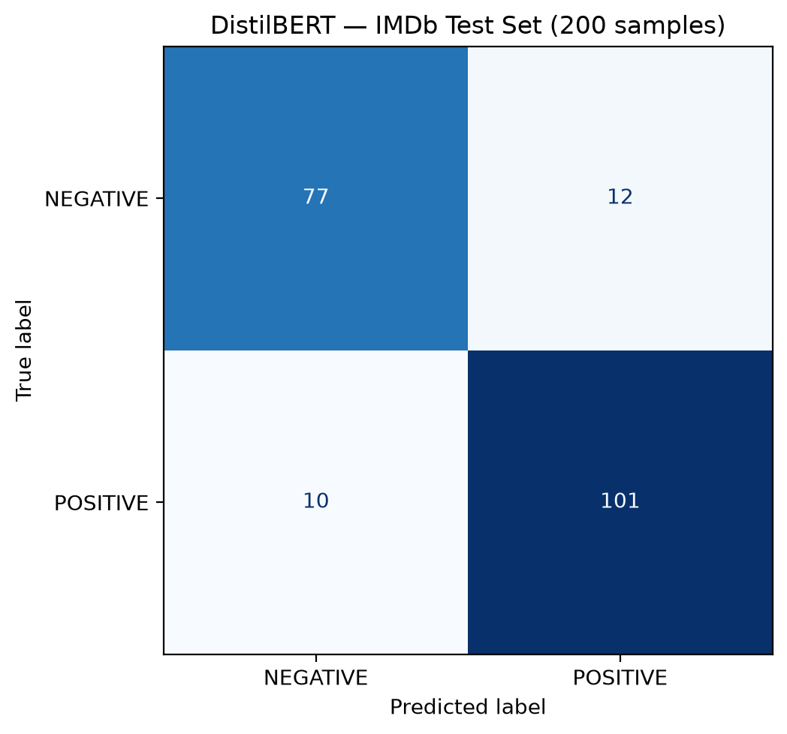

# Lab 3 – Phân tích cảm xúc với Hugging Face

Bài thực hành Deep Learning của nhóm 4: sử dụng mô hình pretrained để phân tích cảm xúc và fine-tune DistilBERT cho bài toán phân loại văn bản nhị phân.

## 1. Nội dung bài thực hành

| Bài | Notebook | Nội dung |
|---|---|---|
| Exercise 1 | [Lab3_Exercise1_Sentiment_Analysis.ipynb](Lab3_Exercise1_Sentiment_Analysis.ipynb) | Tải mô hình phân tích cảm xúc, tokenize một câu và dự đoán cảm xúc |
| Exercise 2 | [Lab3_Exercise2_FineTunning.ipynb](Lab3_Exercise2_FineTunning.ipynb) | Tải IMDb, tiền xử lý, cấu hình TrainingArguments, huấn luyện bằng Trainer và đánh giá |

Exercise 1 sử dụng `distilbert/distilbert-base-uncased-finetuned-sst-2-english`, mô hình đã được huấn luyện cho phân tích cảm xúc. Bài này thực hiện suy luận, không huấn luyện lại.

Exercise 2 sử dụng `distilbert/distilbert-base-uncased` với đầu phân loại hai nhãn: `0 = NEGATIVE`, `1 = POSITIVE`. Code mô hình trong notebook không đóng băng encoder; các tham số được phép cập nhật khi huấn luyện.

## 2. Dữ liệu và cấu hình EX2

Dữ liệu được tải từ `stanfordnlp/imdb`. Tập train gốc được chia thành hai phần bằng stratified split; tập con train và validation được lấy từ hai phần riêng biệt. Test được lấy từ split test gốc.

| Thành phần | Cấu hình của kết quả đã lưu |
|---|---|
| Train thực sự truyền vào Trainer | 1.000 mẫu, 500 mẫu mỗi lớp |
| Validation thực sự truyền vào Trainer | 200 mẫu, 100 mẫu mỗi lớp |
| Test đánh giá cuối | 200 mẫu, 89 tiêu cực và 111 tích cực |
| Độ dài tối đa | 256 token |
| Padding | Theo câu dài nhất trong mỗi batch |
| Thiết bị | CPU |
| Epoch | 2 |
| Batch size train / evaluation | 8 / 8 |
| Learning rate | 0,00002 |
| Weight decay | 0,01 |
| Optimizer | AdamW của PyTorch |
| Chọn checkpoint | Accuracy trên validation |
| Checkpoint tốt nhất | `results_imdb/checkpoint-125` |
| Số bước huấn luyện | 250 |

**Lưu ý về thứ tự cell:** notebook ban đầu tạo test cân bằng 500 mẫu. Một cell sau tokenization giảm các biến dữ liệu gốc xuống 400 train, 100 validation và 200 test. Việc này không thay đổi `tokenized_train` và `tokenized_val` đã tạo, nên Trainer vẫn huấn luyện trên 1.000 mẫu và đánh giá validation trên 200 mẫu. Phần cuối tạo lại `tokenized_test_final` từ đúng 200 mẫu test gốc để đánh giá. Vì vậy, các con số 400/100 ở cell thử nghiệm không phải kích thước train/validation của kết quả cuối.

## 3. Kết quả đánh giá EX2

Nguồn: [test_metrics.json](outputs/exercise2/test_metrics.json) và [classification_report.txt](outputs/exercise2/classification_report.txt).

| Chỉ số | Giá trị |
|---|---:|
| Accuracy | 89,00% |
| Precision – lớp POSITIVE | 89,38% |
| Recall – lớp POSITIVE | 90,99% |
| F1-score – lớp POSITIVE | 90,18% |

Mô hình dự đoán đúng 178/200 mẫu test.

| Nhãn thực tế / Nhãn dự đoán | NEGATIVE | POSITIVE |
|---|---:|---:|
| NEGATIVE | 77 | 12 |
| POSITIVE | 10 | 101 |



Trong output huấn luyện đã lưu, accuracy validation của epoch 1 là 90,50%, cao hơn epoch 2 là 89,50%. Checkpoint ở bước 125 được chọn cho đánh giá cuối. Kết quả chỉ phản ánh tập con thử nghiệm; không đại diện cho toàn bộ IMDb hoặc các miền văn bản khác. Bốn câu dự đoán minh họa không thay thế đánh giá trên tập test.

## 4. Các file kết quả

| File | Nội dung |
|---|---|
| [test_metrics.json](outputs/exercise2/test_metrics.json) | Metrics và đường dẫn checkpoint tốt nhất |
| [classification_report.txt](outputs/exercise2/classification_report.txt) | Precision, recall, F1 và support theo lớp |
| [confusion_matrix.csv](outputs/exercise2/confusion_matrix.csv) | Ma trận nhầm lẫn dạng bảng |
| [confusion_matrix.png](outputs/exercise2/confusion_matrix.png) | Hình ma trận nhầm lẫn |
| [test_predictions.csv](outputs/exercise2/test_predictions.csv) | Văn bản, nhãn thật, nhãn dự đoán và kết quả đúng/sai |
| [sample_predictions.csv](outputs/exercise2/sample_predictions.csv) | Dự đoán của bốn câu minh họa |

Checkpoint, môi trường ảo, dữ liệu và thư mục `outputs/exercise2/final_model/` được loại khỏi Git bằng `.gitignore`. Clone repo chỉ có notebook và báo cáo đã lưu, không có trọng số fine-tune. Cần chạy huấn luyện hoặc cung cấp lại checkpoint cục bộ để đánh giá/dự đoán bằng mô hình của lần chạy này.

## 5. Chuẩn bị và chạy

Ví dụ trên Windows PowerShell, dùng Python 3.11:

```powershell
git clone https://github.com/baochan24/Lab3_DL_Group4.git
cd Lab3_DL_Group4
py -3.11 -m venv .venv311
.\.venv311\Scripts\python.exe -m pip install torch "transformers==4.57.1" "datasets==3.3.2" "evaluate==0.4.6" "accelerate==1.11.0" scikit-learn pandas matplotlib ipykernel
.\.venv311\Scripts\python.exe -m ipykernel install --user --name lab3-py311 --display-name "Python 3.11 (Lab3)"
```

Các phiên bản Transformers, Datasets, Evaluate và Accelerate trên dựa vào output môi trường EX2 đã lưu. Repo chưa có file khóa đầy đủ dependencies nên chưa bảo đảm tái lập chính xác mọi phiên bản và kết quả trên máy khác.

Mở repo bằng VS Code có hỗ trợ Jupyter, chọn kernel **Python 3.11 (Lab3)** và chạy các cell theo thứ tự từ trên xuống. Cần Internet cho lần tải đầu mô hình và dataset. Có thể đọc output có sẵn trên GitHub mà không chạy lại huấn luyện.

Notebook EX1 lưu output từ môi trường Python 3.13.7 / Transformers 5.21.0; EX2 lưu output từ Python 3.11.9 / Transformers 4.57.1. Các môi trường này không được đưa lên Git.

Máy thực nghiệm EX2 dùng CPU và RAM khoảng 8 GB, từng gặp lỗi thiếu bộ nhớ. Thời gian và khả năng chạy lại phụ thuộc bộ nhớ khả dụng của máy. Cell huấn luyện sẽ cập nhật trọng số khi chạy lại; nếu chỉ xem kết quả thì sử dụng các output đã lưu.

Sau khi chạy cell xuất mô hình, mô hình và tokenizer được tạo cục bộ trong `outputs/exercise2/final_model/`.

## 6. Phạm vi kiểm tra

Các notebook và file báo cáo đã lưu thể hiện các bước suy luận EX1, huấn luyện và đánh giá EX2, dự đoán câu mới và xuất mô hình. Việc rà soát repo là kiểm tra code và output có sẵn; chưa phải xác nhận đã chạy lại toàn bộ notebook trong một môi trường sạch.
